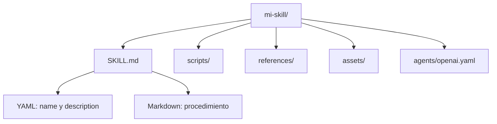
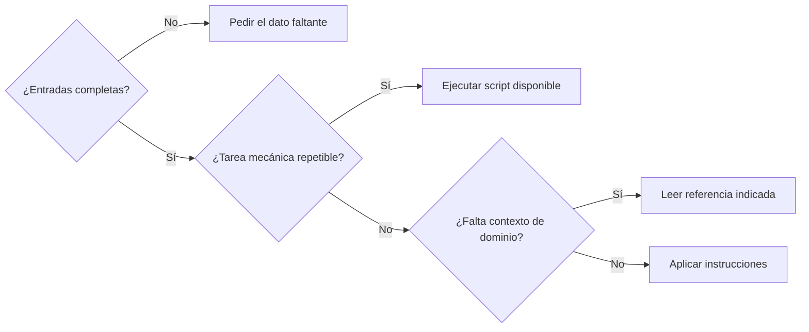
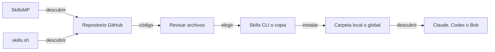

# Cómo funcionan los skills de agentes de IA

Un **skill** reúne instrucciones en `SKILL.md` y recursos opcionales para que un agente siga un procedimiento. El agente interpreta el Markdown y usa herramientas para ejecutar los scripts cuando la tarea lo requiere.

- El nombre y la descripción permiten descubrirlo; el contenido completo se carga cuando se utiliza.[^spec]
- Claude Code, Codex e IBM Bob tienen rutas de instalación diferentes.[^agents]
- Un buen skill define entradas, decisiones, pasos, resultados y cómo comprobarlos.[^codex]


## ¿Cómo actúa un skill durante una tarea?

```mermaid
flowchart LR
  peticion["Usuario"]
  catalogo["Metadatos"]
  activar["Elegir skill"]
  leer["Leer SKILL.md"]
  recursos-paso["Evaluar recursos"]
  aplicar["Aplicar pasos"]
  verificar["Verificar"]
  peticion -->|tarea| catalogo
  catalogo -->|coincidencia| activar
  activar -->|activar| leer
  leer -->|instrucciones| recursos-paso
  recursos-paso -->|según tarea| aplicar
  aplicar -->|evidencia| verificar
```




1. **Usuario:** Por ejemplo: «Revisa este archivo y genera un informe».
2. **Metadatos:** El agente conoce el nombre y la descripción de los skills disponibles.
3. **Elegir skill:** Se activa por solicitud explícita o por una tarea que coincide con su descripción.
4. **Leer SKILL.md:** El agente lee el procedimiento completo antes de aplicarlo.
5. **Evaluar recursos:** Decide qué referencias, plantillas o scripts necesita para esta tarea.
6. **Aplicar pasos:** Lee referencias, usa plantillas o ejecuta scripts con herramientas si hacen falta.
7. **Verificar:** Revisa el resultado con los criterios indicados y comunica el producto final.

La carga progresiva evita incorporar todos los archivos de todos los skills al contexto. El detalle de selección depende del agente.[^spec][^codex]

## ¿Qué archivos contiene?




| Archivo o carpeta | Función | ¿Es obligatorio? |
| --- | --- | --- |
| `SKILL.md` | Metadatos YAML al inicio; instrucciones Markdown después. | Sí, en el formato abierto. |
| `scripts/` | Código para cálculos, conversiones o tareas repetibles. | No. |
| `references/` | Documentación que el agente consulta cuando corresponde. | No. |
| `assets/` | Plantillas, imágenes, ejemplos de salida y otros recursos. | No. |
| `agents/openai.yaml` | Presentación, política de invocación y dependencias en Codex. | No; extensión específica del agente. |

El árbol descompone conceptualmente `SKILL.md` en cabecera y cuerpo; esas dos partes pertenecen al mismo archivo. Las carpetas auxiliares son convenciones recomendadas.[^spec][^codex]

## ¿Qué lenguaje se utiliza y quién lo ejecuta?

| Formato o lenguaje | Uso dentro del skill | Quién lo interpreta o ejecuta |
| --- | --- | --- |
| Markdown `.md` | Pasos, decisiones, ejemplos y referencias. | El modelo interpreta las instrucciones. |
| YAML | Metadatos entre delimitadores `---`. | El agente o su cargador lee los campos. |
| Python `.py` | Procesar archivos, calcular, transformar datos. | Un intérprete Python mediante una herramienta. |
| JavaScript `.js` o `.mjs` | Automatización, APIs, generación de HTML. | Node.js u otro entorno compatible. |
| TypeScript `.ts` | Automatización con tipos. | Un entorno que soporte TS o código compilado a JS. |
| Bash o Shell `.sh` | Encadenar herramientas de terminal. | Una shell disponible en el sistema. |
| JSON, CSV y otros datos | Configuración, esquemas y ejemplos. | El script o la herramienta que los consuma. |

Un skill puede funcionar solo con Markdown. Los lenguajes de scripts dependen del entorno y de las herramientas del agente. Instalar el skill tampoco instala automáticamente Python, Node.js o sus dependencias.[^spec]

```bash
python3 scripts/validar.py entrada.json
node scripts/generar.mjs entrada.json
bash scripts/comprobar.sh
```

## ¿Qué cambia entre Claude Code, Codex e IBM Bob?

| Agente | Instalación local en el proyecto | Instalación personal o global |
| --- | --- | --- |
| Claude Code | `.claude/skills/mi-skill/SKILL.md` | `~/.claude/skills/mi-skill/SKILL.md` |
| Codex | `.agents/skills/mi-skill/SKILL.md` | `~/.agents/skills/mi-skill/SKILL.md` |
| IBM Bob | `.bob/skills/mi-skill/SKILL.md` | `~/.bob/skills/mi-skill/SKILL.md` |
| Cursor, vía Skills CLI | `.agents/skills/mi-skill/SKILL.md` | `~/.cursor/skills/mi-skill/SKILL.md` |
| GitHub Copilot, vía Skills CLI | `.agents/skills/mi-skill/SKILL.md` | `~/.copilot/skills/mi-skill/SKILL.md` |

En Claude Code se puede invocar con `/nombre-del-skill`. En Codex CLI y su extensión se puede seleccionar con `/skills` o mencionar con `$nombre-del-skill`. Ambos admiten selección por descripción.[^claude][^codex]

Las rutas de IBM Bob, Cursor y Copilot y el identificador `bob` se verificaron en Skills CLI. No se confirmó aquí una sintaxis nativa de invocación de Bob.[^agents]

El formato base es compartido; las opciones específicas requieren comprobar compatibilidad. Por ejemplo, `agents/openai.yaml` pertenece a Codex y `context: fork` es una opción de Claude Code.[^codex][^claude]

## ¿Cómo escribir un árbol de decisiones en Markdown?

Define preguntas observables y una acción para cada respuesta. Este método es una recomendación de diseño para evitar instrucciones ambiguas.




```markdown
## Decisiones
- Si falta la ruta del archivo: pedirla antes de continuar.
- Si la tarea exige un cálculo repetible:
  - Si existe un script adecuado: usarlo.
  - Si no existe: seguir el procedimiento manual documentado.
- Si falta contexto del dominio: leer references/reglas.md.
- Si las entradas están completas: aplicar el procedimiento.
- Después de cualquier ruta: verificar el resultado.
- Si falla la verificación: corregir la causa y volver a verificar.
```

Las condiciones escritas guían al modelo. Para una validación estricta de datos o cálculos, implementa también la comprobación en un script.

## ¿Qué técnicas de Markdown ayudan a crear buenos skills?

| Técnica | Cómo escribirla | Para qué sirve |
| --- | --- | --- |
| Contrato de entrada y salida | `## Entradas` y `## Salida` | Define qué recibir y qué entregar. |
| Pasos numerados | `1. Inspecciona...` | Expresa un orden de trabajo. |
| Árbol de decisiones | Listas con condiciones `Si...` | Elige rutas según hechos observables. |
| Tabla de decisión | Condición, acción y comprobación. | Compara varios casos sin repetir pasos. |
| Ejemplos de entrada y salida | Bloques de código con casos concretos. | Aclara el formato esperado. |
| Checklist final | `- [ ] Comprueba...` | Define los criterios de aceptación. |
| Referencias progresivas | Enlace relativo con cuándo leerlo. | Mantiene corto el archivo principal. |
| Límites y recuperación | `Si falla X, haz Y`. | Evita reintentos sin criterio. |

Estas técnicas son recomendaciones de autoría. La especificación permite instrucciones libres y recomienda separar referencias extensas del archivo principal.[^spec]

```yaml
---
name: revisar-documento
description: Revisa claridad y estructura de un texto y entrega hallazgos priorizados. Usar cuando pidan revisar un borrador. No usar para traducir.
---
```

```markdown
# Revisar documento

## Entradas
Recibe el texto o su ruta, el público y el objetivo.

## Procedimiento
1. Lee el documento completo.
2. Identifica el objetivo y los criterios de revisión.
3. Aplica las decisiones de la sección siguiente.
4. Entrega hallazgos con ubicación y una propuesta concreta.

## Decisiones
- Si falta el texto o el archivo: solicita ese dato.
- Si el público no se conoce: declara el supuesto que usarás.
- Si se requiere una guía de estilo: lee references/estilo.md.

## Salida
Entrega una tabla: ubicación, problema, propuesta y prioridad.

## Verificación
- [ ] Cada hallazgo apunta a un fragmento real.
- [ ] Las propuestas preservan la intención del autor.
- [ ] Los supuestos quedan visibles.
```

## ¿Dónde se encuentran y cómo llegan al agente?




| Lugar | Qué aporta |
| --- | --- |
| [SkillsMP](https://skillsmp.com/) | Catálogo para descubrir skills y abrir su origen. No certifica ni instala los skills que indexa. |
| [skills.sh](https://skills.sh/) | Directorio del ecosistema y acceso a comandos del instalador Skills CLI. |
| [GitHub](https://github.com/) | Archivos, historial, licencia y versiones del repositorio fuente. |
| [anthropics/skills](https://github.com/anthropics/skills) | Colección de Anthropic. |
| [openai/skills](https://github.com/openai/skills) | Colección de OpenAI. |
| [vercel-labs/agent-skills](https://github.com/vercel-labs/agent-skills) | Colección de Vercel. |
| [tt-a1i/archify](https://github.com/tt-a1i/archify) | Skill usado para generar esta guía visual. |

También puedes llegar directamente a un repositorio sin pasar por un catálogo. Revisa la licencia, el procedimiento y los scripts antes de instalarlos.[^skillsmp][^skillssh][^cli]

## ¿Cómo instalar un skill local o globalmente?

Skills CLI es un instalador de terceros. Ejecuta los comandos locales desde la raíz del proyecto; `-g` cambia el alcance a tu usuario.[^cli]

```bash
npx skills add tt-a1i/archify --list
```

```bash
npx skills add tt-a1i/archify --skill archify --agent claude-code codex bob
```

```bash
npx skills add tt-a1i/archify --skill archify --agent claude-code codex bob -g
```

| Opción | Efecto |
| --- | --- |
| Sin `-g` | Disponible en el proyecto donde ejecutas el comando. |
| `-g` o `--global` | Disponible para tu usuario en varios proyectos de esa máquina. |
| `--skill archify` | Selecciona un skill del repositorio. |
| `--agent codex` | Elige el agente de destino. Admite varios agentes. |
| `--copy` | Crea copias en lugar de enlaces simbólicos. |
| `-y` | Omite los diálogos del instalador; úsalo tras revisar lo que instalarás. |

Global significa el alcance del skill para tu usuario. No equivale a `npm install -g`, ni lo instala para todos los usuarios del equipo. El instalador puede usar una copia compartida y enlaces a las rutas de los agentes.[^cli]

```bash
npx skills list
npx skills list -g
npx skills check
npx skills update
npx skills remove archify
```

También puedes crear manualmente la carpeta del skill y guardar allí `SKILL.md` y sus recursos, usando las rutas de la tabla de agentes.[^spec][^agents]

## ¿Cómo comprobar que el skill está bien construido?

- [ ] El nombre identifica una tarea concreta y coincide con la carpeta.
- [ ] La descripción explica cuándo usarlo y delimita su alcance.
- [ ] La cabecera YAML contiene `name` y `description`.
- [ ] Cada referencia y script mencionado existe en una ruta relativa.
- [ ] Las dependencias de los scripts están documentadas.
- [ ] Se probó con un caso válido, uno incompleto y uno fuera de alcance.
- [ ] La salida cumple criterios que se pueden comprobar.
- [ ] El agente encuentra el skill en el alcance local o global esperado.

Un skill orienta el trabajo del agente; los permisos, herramientas y políticas del entorno siguen determinando qué acciones se pueden ejecutar.[^claude][^codex]

## Fuentes

Consultadas el 23 de octubre de 2026.

[^spec]: [Agent Skills: especificación abierta](https://agentskills.io/specification)
[^claude]: [Claude Code: crear y usar skills](https://code.claude.com/docs/en/skills)
[^codex]: [OpenAI: Build skills](https://learn.chatgpt.com/docs/build-skills)
[^agents]: [Skills CLI: agentes y rutas de instalación](https://github.com/vercel-labs/skills/blob/main/docs/agents.md)
[^cli]: [Skills CLI: instalación y comandos](https://github.com/vercel-labs/skills/blob/main/docs/commands.md)
[^skillsmp]: [SkillsMP: catálogo de skills](https://skillsmp.com/)
[^skillssh]: [skills.sh: directorio del ecosistema](https://skills.sh/)
[^anthropicrepo]: [Repositorio de skills de Anthropic](https://github.com/anthropics/skills)
[^openairepo]: [Repositorio de skills de OpenAI](https://github.com/openai/skills)
[^vercelrepo]: [Repositorio de skills de Vercel](https://github.com/vercel-labs/agent-skills)
[^archify]: [Archify: skill para diagramas interactivos](https://github.com/tt-a1i/archify)
